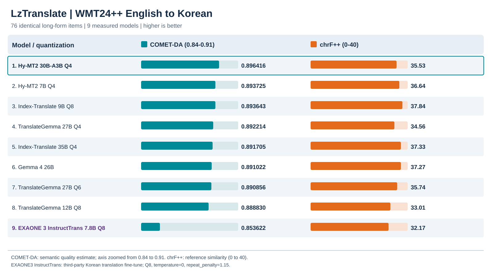

# LzTranslate

## 성능 비교

WMT24++ 영→한 장문 76항목에서 동일한 원문·참조 번역을 사용해 평가했습니다.



<table>
<thead><tr><th>#</th><th>실측 모델</th><th>COMET-DA ↑</th><th>chrF++ ↑</th><th>BLEU ↑</th></tr></thead>
<tbody>
<tr><td align="center">1</td><td>Hy-MT2 30B-A3B Q4</td><td align="right">0.896416</td><td align="right">35.532</td><td align="right">13.883</td></tr>
<tr><td align="center">2</td><td>Hy-MT2 7B Q4</td><td align="right">0.893725</td><td align="right">36.636</td><td align="right">15.579</td></tr>
<tr><td align="center">3</td><td>Index-Translate 9B Q8</td><td align="right">0.893643</td><td align="right">37.842</td><td align="right">16.016</td></tr>
<tr><td align="center">4</td><td>TranslateGemma 27B Q4</td><td align="right">0.892214</td><td align="right">34.558</td><td align="right">13.263</td></tr>
<tr><td align="center">5</td><td>Index-Translate 35B Q4</td><td align="right">0.891705</td><td align="right">37.330</td><td align="right">15.743</td></tr>
<tr><td align="center">6</td><td>Gemma 4 26B</td><td align="right">0.891022</td><td align="right">37.272</td><td align="right">14.575</td></tr>
<tr><td align="center">7</td><td>TranslateGemma 27B Q6</td><td align="right">0.890856</td><td align="right">35.740</td><td align="right">14.392</td></tr>
<tr><td align="center">8</td><td>TranslateGemma 12B Q8</td><td align="right">0.888830</td><td align="right">33.009</td><td align="right">11.738</td></tr>
<tr><td align="center">9</td><td>EXAONE 3 InstructTrans 7.8B Q8</td><td align="right">0.853622</td><td align="right">32.174</td><td align="right">12.167</td></tr>
</tbody>
</table>

- **COMET-DA 1위(관측값):** Hy-MT2 30B Q4 — 0.896416. Hy-MT2 7B와의 차이는 통계적으로 확정되지 않았습니다.
- **EXAONE 3 instructTrans 7.8B Q8:** COMET-DA 0.853622. 영→한 번역 특화 모델의 76개 출력 검증을 완료했습니다.

## 사용법

기본 모델: `hy30`.

```bat
out\translate.bat "subtitles.srt"
out\translate.bat "document.txt"
out\translate.bat "document.md" --source-language Japanese
out\translate.bat --help
```

엔진·모델은 저장소 밖에 보관하며, 필요하면 `LZTRANSLATE_APP_HOME` 환경변수로 위치를 지정할 수 있습니다.

## 용어집

| 용어 | 설명 |
|---|---|
| WMT24++ | 다국어 기계번역 평가 데이터셋 |
| COMET-DA | 원문·번역·참조 기반 의미 품질 추정 지표(높을수록 좋음) |
| chrF++ | 문자·단어 기반 참조 번역 유사도 |
| BLEU | n-gram 기반 참조 번역 유사도 |
| MQM | 전문가의 번역 오류 평가 체계 |
| GGUF / Q4·Q6·Q8 | 모델 파일 형식 및 양자화 수준 |

## 출처

- [WMT24++](https://huggingface.co/datasets/google/wmt24pp)
- [COMET-DA](https://huggingface.co/Unbabel/wmt22-comet-da)
- [Hy-MT2](https://huggingface.co/tencent/Hy-MT2-30B-A3B)
- [EXAONE instructTrans EN→KO](https://huggingface.co/Translation-EnKo/exaone3-instrucTrans-v2-enko-7.8b)

이 결과는 표시된 영어→한국어 표본에 한정됩니다.
